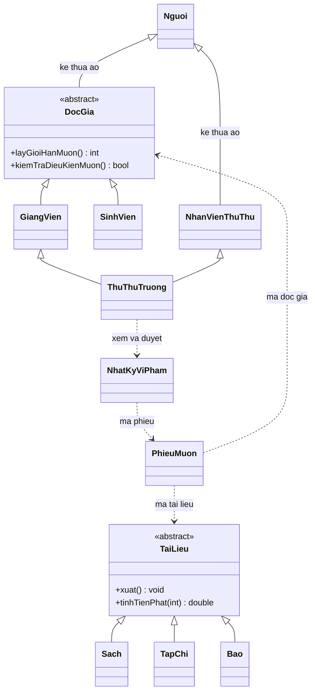

# Báo cáo Hệ thống Quản lý Thư viện Đại học

## Mở đầu

Chương trình quản lý tài liệu, độc giả, nhân sự, mượn/trả và tiền phạt tại thư viện đại học. Yêu cầu chức năng và OOP được đối chiếu với hai tài liệu bài tập lớn ở thư mục gốc. Cách trình bày tham khảo docs/phancode1.cpp, giữ cấu trúc nhiều file .h và .cpp.

Báo cáo này mô tả bản cài đặt và các phép kiểm tra đã chạy. Các mức phạt, hạn mức và phụ cấp sử dụng giá trị đề xuất trong đặc tả, được ghi rõ trong README.

## Chương 1. Phân tích

Các đối tượng chính là Nguoi, DocGia, SinhVien, GiangVien, NhanVienThuThu, ThuThuTruong, TaiLieu, Sach, TapChi, Bao, PhieuMuon và NhatKyViPham.

Quy trình mượn kiểm tra độc giả, tài liệu, trạng thái tài khoản, hạn mức, tồn kho và mã phiếu. Chỉ khi các điều kiện hợp lệ mới giảm số còn trong kho và tăng số đang mượn của độc giả.

Quy trình trả kiểm tra phiếu chưa trả và ngày hợp lệ, cập nhật hai số lượng, sau đó ghi tiền phạt. Tiền phạt bằng số ngày trễ nhân mức phạt của loại tài liệu và số bản mượn. Vi phạm được ghi một lần khi trả trễ; thanh toán không thực hiện hai lần.

Khi xóa đối tượng không còn đang mượn, các phiếu đã trả vẫn giữ mã và lịch sử tiền phạt. Không cấp lại mã đó cho người hoặc tài liệu mới. Khi đọc tệp, phiếu đang mượn phải có đủ đối tượng liên quan và số lượng phải khớp các danh sách.

## Chương 2. Thiết kế lớp

DocGia và NhanVienThuThu kế thừa ảo Nguoi, do đó ThuThuTruong chỉ có một phần dữ liệu Nguoi. Khi nhập hoặc xuất thủ thư trưởng, thông tin chung được xử lý một lần, sau đó xử lý thông tin riêng của hai nhánh.

DanhSachQuanLy<T> sử dụng T* ds, soLuong và sucChua. Danh sách tài liệu và độc giả lưu con trỏ lớp cơ sở để giữ đa hình. Danh sách nhân sự, phiếu và vi phạm lưu đối tượng. Template giải phóng mảng; lớp quản lý con trỏ giải phóng các đối tượng. Không cho sao chép các danh sách sở hữu con trỏ.

QuanLyThuVien điều phối các danh sách và đọc/ghi dữ liệu liên quan. Các lớp quản lý từng nhóm chịu trách nhiệm tìm kiếm, thêm, sửa, xóa và sắp xếp. Menu.cpp gọi các chức năng này; main.cpp chỉ gọi menuChinh.

Ba toán tử được sử dụng là operator+ của DocGia, operator<< và operator< của PhieuMuon. Ba hàm friend được sử dụng là kiemTraHanMuon, operator<< và kiemTraDieuKienMuon. Bảng chi tiết nằm trong DoiChieuYeuCau.md.

## Chương 3. Cài đặt và kiểm thử

### Cách cài đặt

Nhập chuỗi bằng getline, nhập số từ một dòng và kiểm tra toàn bộ dòng. Hàm nhap trả bool. Các lớp con nhập vào đối tượng tạm rồi gán lại khi tất cả dữ liệu hợp lệ. Các constructor có tham số giữ giá trị đầu vào; hopLe kiểm tra chúng, và lớp quản lý từ chối đối tượng không hợp lệ.

Chương trình không dùng vector, std::sort, bits/stdc++.h, lambda, std::quoted hoặc constructor ủy quyền. Các constructor lớp con vẫn gọi constructor lớp cơ sở theo đúng yêu cầu OOP. Ngoại lệ chỉ dùng để báo chỉ số sai ở operator[] vì hàm này phải trả tham chiếu T&; các nghiệp vụ thông thường trả bool.

Selection Sort sắp tài liệu theo năm, Quick Sort theo giá trị, Bubble Sort sắp độc giả theo số đang mượn và Merge Sort sắp phiếu theo mã. Tìm kiếm gồm tuần tự, nhị phân và bảng băm tự cài đặt bằng thăm dò tuyến tính.

Tìm nhị phân tạo mảng con trỏ phụ, sắp theo mã và trả đối tượng tìm được mà không đổi thứ tự danh sách chính. Bảng băm độc giả được xây lại khi tra cứu; cách này đơn giản và tránh chỉ mục cũ sau sửa/xóa, nhưng cần tính thêm chi phí xây bảng khi đánh giá tốc độ của cả chức năng.

Tệp mới có dòng THUVIEN_2, số bản ghi và từng trường trên một dòng. Bộ đọc tài liệu hỗ trợ định dạng cũ có ngoặc kép. Đọc toàn hệ thống vào danh sách tạm, kiểm tra tính nhất quán rồi mới đổi dữ liệu. Lưu ghi chín tệp tạm trước và dùng bản sao để khôi phục nếu thao tác thay tệp bị lỗi.

### Kết quả kiểm tra

Kiểm tra bằng g++ với C++17, -Wall -Wextra -Wpedantic và -O2 trên Windows/MinGW. Không có cảnh báo biên dịch trong lần chạy bàn giao. Máy kiểm tra không có CMake trong PATH, nên chưa chạy CMake/CTest; script build.ps1 đã biên dịch và chạy các bộ kiểm thử.

| Bộ kiểm thử | Số kiểm tra | Số lỗi |
|---|---:|---:|
| kiemThuTaiLieu.cpp | 467 | 0 |
| kiemThuThuVien.cpp | 360 | 0 |
| kiemThuMenu.ps1 | 23 | 0 |

Các kiểm tra bao gồm:

- Nhập/xuất chuỗi có khoảng trắng, dữ liệu thiếu, số có ký tự dư, giá âm/vô hạn, kho không hợp lệ và ngày không tồn tại.
- Thêm/sửa/xóa, mã trùng, chèn sai vị trí, tìm thấy/không thấy và danh sách rỗng.
- Đa hình tiền phạt, hạn mức sinh viên/giảng viên, operator+, operator<< và ba hàm friend.
- Hai nhánh thủ thư trưởng trỏ tới cùng một Nguoi; lương, phụ cấp và số nhân viên hợp lệ.
- Mượn vượt hạn mức hoặc tồn kho, tài khoản khóa, mã liên quan không tồn tại, phiếu trùng, trả trước ngày mượn và trả hai lần.
- Tiền phạt theo số bản, qua tháng nhuận và qua năm; ghi/thu/duyệt vi phạm không trùng.
- Khôi phục đúng loại đối tượng, trạng thái thanh toán và người duyệt; từ chối tệp thiếu, thừa, sai hoặc lệch dữ liệu.
- Lỗi ở tệp thứ tám khi lưu: các tệp đã thay trước đó được khôi phục và thư mục tạm được dọn.
- Bốn thuật toán sắp xếp với dữ liệu tăng, giảm, trùng và số âm; kiểm tra thứ tự và số lần xuất hiện của từng phần tử.
- Menu thật: nhập sai, EOF, sửa, mượn/trả, tính phạt, thanh toán, duyệt, lưu/đọc và giữ lịch sử sau xóa.

Các bộ kiểm thử sử dụng dữ liệu tự tạo được ghi rõ là dữ liệu thử. Kết quả được lấy từ việc thực thi chương trình, không gán trước trạng thái đạt.

### Thực nghiệm thuật toán

File KetQuaThucNghiem.csv chứa 28 dòng kết quả cho bốn kích thước 100, 500, 1000 và 2000. Mỗi kích thước chạy bốn thuật toán sắp xếp và ba thuật toán tìm kiếm.

Đầu vào sắp xếp là các số nguyên duy nhất theo thứ tự giảm. Sau chạy, chương trình kiểm tra mảng đúng dãy từ 0 đến n-1. Tìm kiếm chạy 1000 lượt, kiểm tra đúng vị trí hoặc -1. Bảng băm dùng khóa chuỗi biểu diễn số.

Đơn vị thời gian là micro giây. Thời gian tìm kiếm không gồm sắp xếp và xây bảng băm; có gồm chi phí đổi số thành chuỗi của phép tra bảng. Mỗi thuật toán sắp xếp được đo một lần, nên số liệu chịu ảnh hưởng của tải máy. Đây là thực nghiệm minh họa với bốn kích thước, chưa phải kết luận hiệu năng cho mọi loại dữ liệu hoặc toàn ứng dụng.

## Kết luận

Bản cài đặt có đủ các nhóm menu, lớp bắt buộc, đa hình, kế thừa ảo/nhiều, template, friend, toán tử, ba cách tìm kiếm, bốn cách sắp xếp và đọc/ghi chín tệp. Các bộ kiểm tra đã chạy không phát hiện lỗi trong những trường hợp được liệt kê.

Cơ chế khôi phục tệp xử lý lỗi thao tác ghi/thay thông thường, chưa bảo đảm giao dịch khi mất điện. Hồ sơ thủ thư trưởng dùng nhánh giảng viên để thể hiện đa kế thừa; chức năng mượn/trả sử dụng hồ sơ trong danh sách độc giả. Các mức nghiệp vụ là quy ước đề xuất cần được nhóm giữ thống nhất khi trình bày với giáo viên.
